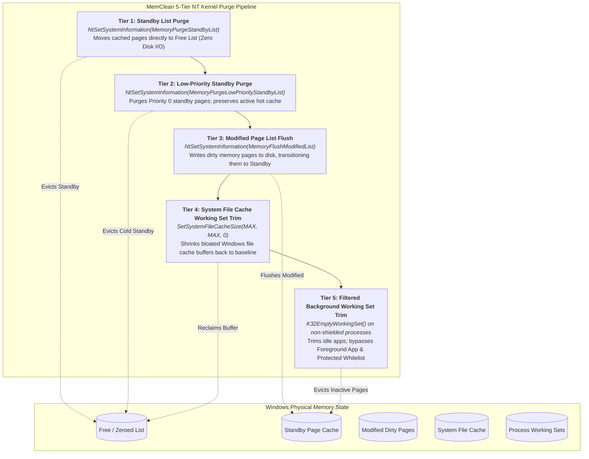

# MemClean

<p align="center">
  
</p>

<p align="center">
  <strong>Ultra-lightweight, developer-grade Windows memory optimizer engineered in pure Rust.</strong><br/>
  <em>Sub-500 KB binary &bull; &lt; 2 MB RAM footprint &bull; 0.0% idle CPU &bull; 5-tier NT kernel purging &bull; Zero frame-drop game shielding.</em>
</p>

<p align="center">
  <a href="https://github.com/Xenonesis/memclean/releases"></a>
  
  
  <a href="https://github.com/Xenonesis/memclean/blob/main/LICENSE"></a>
  
  
  
</p>

---

## Overview

**MemClean** is a high-performance, open-source Windows memory optimization daemon and CLI utility engineered from scratch in pure Rust. It replaces legacy tools like Sordum ReduceMemory, eliminating bloated script runtimes, blind working-set evictions, and annoying recurring UAC prompts.

By interacting directly with undocumented NT kernel memory manager routines (`NtSetSystemInformation`) and the Windows cache subsystem (`SetSystemFileCacheSize`), MemClean purges cached and modified page lists without incurring the disk thrashing and frame stutters common to conventional cleaners.

### Why MemClean?
- **True Native Footprint:** Built on pure Win32 and NT kernel system calls with zero external DLL dependencies. Consumes **< 2 MB RAM** and **0.0% CPU** at idle.
- **5-Tier Purge Engine:** Surgical control over Standby lists, Modified page lists, System File Cache, and background process working sets.
- **Smart Game Guard:** Automatically detects active fullscreen 3D engines and exempts foreground processes, guaranteeing zero micro-stuttering or 0.1% low drops.
- **Silent Zero-UAC Elevation:** Integrates with the Windows Task Scheduler (`TASK_RUNLEVEL_HIGHEST`) to launch automatically at login with full administrator privileges without annoying UAC prompts.
- **Dual-Mode Executable:** A single binary functions as both an interactive Win32 system tray daemon and a scriptable, headless CLI.

---

## Side-by-Side Comparison: MemClean vs. Sordum ReduceMemory

| Feature / Metric | MemClean | Sordum ReduceMemory (v1.6) | Architectural Advantage |
| :--- | :---: | :---: | :--- |
| **Memory Overhead** | **&lt; 2 MB** | 15 &ndash; 25 MB | **10x &ndash; 15x lighter** background footprint |
| **Runtime Engine** | **Native Rust (Win32 API)** | AutoIt / VBScript wrapper | Compiled machine code, no interpreter engine |
| **Standby List Purge** | **Yes (`NtSetSystemInformation`)** | None / Basic | Reclaims unpaged cached pages directly to Free List |
| **Low-Priority Standby List** | **Yes (Priority-0 Target)** | No | Selectively frees cold cache while retaining hot data |
| **Modified Page List Flush** | **Yes** | No | Flushes dirty pages to disk, converting them into standby |
| **System File Cache Trim** | **Yes (`SetSystemFileCacheSize`)**| No | Clears bloated NTFS/filesystem cache working sets |
| **Smart Game & Foreground Guard** | **Yes (0 Frame Stutter)** | No (Blind Trimming) | Protects active game/app from working set eviction |
| **Silent Zero-UAC Startup** | **Yes (Task Scheduler API)** | No (UAC prompt per boot) | Native `schtasks` integration, zero user prompts |
| **Binary Footprint** | **&lt; 500 KB** | ~1.2 MB | Highly optimized LTO release binary |
| **CLI Automation** | **Full (Console & Status output)** | Limited | Full CLI flags with stdout console attachment |
| **License** | **Open Source (MIT)** | Closed Source Freeware | Verifiable, auditable, and extensible codebase |

---

## 5-Tier NT Kernel Purge Architecture

Standard memory cleaners naively call `EmptyWorkingSet()` across every process. This forces active process memory into the Windows pagefile, causing heavy disk I/O, paging churn, and massive frame stutters when applications immediately page their memory back into physical RAM.

MemClean implements a **5-tier kernel purge pipeline** that respects Windows Virtual Memory Manager page state transitions:



### Detailed Tier Breakdown

```
[ RAM Pages ] ──> [ Tier 1: Standby Purge ] ───> Instant free RAM without disk writes
              ──> [ Tier 2: Low-Pri Standby ] ──> Cleans only stale background cache
              ──> [ Tier 3: Flush Modified ] ───> Flushes dirty pages to pagefile
              ──> [ Tier 4: Trim File Cache ] ──> Resets NTFS kernel file cache
              ──> [ Tier 5: Background WS ] ────> Trims idle apps (Protected by Shield)
```

1. **Tier 1 &mdash; Standby List Purge (`MemoryPurgeStandbyList`, Command 4):**
   Calls `NtSetSystemInformation` with `SystemMemoryListInformation` (class 80). Shifts all standby pages (cached files and code libraries) into the free list. This frees gigabytes of RAM instantaneously without performing any disk writes or degrading application performance.
2. **Tier 2 &mdash; Low-Priority Standby Purge (`MemoryPurgeLowPriorityStandbyList`, Command 5):**
   Targets only lowest-priority standby pages (Priority 0). Allows users on low-spec hardware to clean cold background data while preserving high-priority hot cache.
3. **Tier 3 &mdash; Modified Page List Flush (`MemoryFlushModifiedList`, Command 3):**
   Commands the Windows memory manager to write modified, unwritten pages out to backing store (pagefile or disk), instantly converting dirty pages into standby pages that can subsequently be freed.
4. **Tier 4 &mdash; System File Cache Trim (`SetSystemFileCacheSize`):**
   Calls `SetSystemFileCacheSize(usize::MAX, usize::MAX, 0)`. Forces the operating system to discard working set pages allocated to the system file cache, preventing bloated file copies from starving running processes.
5. **Tier 5 &mdash; Background Working Sets Trim (`K32EmptyWorkingSet`):**
   Enumerates non-system, non-critical background processes and trims their unreferenced working set pages. **Crucially, active foreground applications and whitelisted processes are strictly protected.**

---

## Smart Game Guard & Foreground Shield

Conventional memory optimizers cause frame drops because they blindly strip working sets from whatever game or application you are actively playing. When the game engine accesses its asset buffers a few milliseconds later, a hard page fault occurs, causing a visible micro-stutter.

MemClean includes an intelligent **Smart Game Guard**:

```
Active Window ──> [ GetForegroundWindow() ]
                        │
                  Is Shell Window? (Progman / WorkerW / Shell_TrayWnd)
                        │─── Yes ──> Exclude from shield
                        └─── No  ──> Check Window Bounds & Monitor Info
                                           │
                                     Is Fullscreen?
                                           ├─── Yes ──> GAME MODE ACTIVE (Standby Purge Only)
                                           └─── No  ──> APP SHIELDED (Background Working Sets Trimmed)
```

### How the Guard Works
1. **Real-Time Context Inspection:** Obtains the foreground window handle via `GetForegroundWindow()` and resolves its Process ID (`GetWindowThreadProcessId`).
2. **Shell Exclusion Filter:** Filters out Windows desktop containers (`Progman`, `WorkerW`, `Shell_TrayWnd`) so normal desktop interactions do not trigger false shields.
3. **Fullscreen Detection Logic:** Inspects window coordinates via `GetWindowRect()` and compares them against the bounding rectangle of the target display adapter (`MonitorFromWindow` with `MONITOR_DEFAULTTONEAREST` and `GetMonitorInfoW`). If `rcWindow >= rcMonitor`, the process is recognized as an active fullscreen game or immersive application.
4. **Adaptive Policy Switching:**
   - **When in Fullscreen Game:** Working set trimming is automatically disabled. MemClean restricts itself to Tier 1/2 Standby List and Tier 4 File Cache purging. The game process retains 100% of its working set in physical RAM, ensuring stutter-free 0.1% frame lows.
   - **Foreground App Shield:** Even in windowed mode, the active foreground process PID is exempted from working set eviction.
5. **Kernel Whitelist Protection:** MemClean inherently protects critical operating system and graphics composition processes:
   `system`, `registry`, `smss.exe`, `csrss.exe`, `wininit.exe`, `services.exe`, `lsass.exe`, `dwm.exe`, `fontdrvhost.exe`, and `memclean.exe`.

---

## Installation & Downloads

Download the latest release from the [GitHub Releases](https://github.com/Xenonesis/memclean/releases) page.

### 1. Inno Setup Wizard (`MemClean_Setup.exe`) &mdash; Recommended
The automated installer configures MemClean for daily production use:
- Installs the binary to `C:\Program Files\MemClean` (or per-user directory).
- Automatically configures the **Silent Zero-UAC Elevation Task** in the Windows Task Scheduler.
- Creates Start Menu and optional Desktop shortcuts.
- Clean uninstaller that terminates the running tray daemon and unregisters the scheduled task cleanly (`taskkill` + `schtasks /delete`).

### 2. Standalone Portable (`memclean.exe`)
Ideal for portable flash drives, testing, or custom automated scripts:
- Download `memclean.exe` and place it in any folder.
- Run `memclean.exe --autostart` from an elevated prompt to enable automatic startup, or simply run `memclean.exe` to launch the tray daemon.

### 3. Build from Source
Building from source requires the stable Rust toolchain (Rust 1.70+ recommended, 2021 edition):

```powershell
# Clone the repository
git clone https://github.com/Xenonesis/memclean.git
cd memclean/memclean

# Build with maximum size and link-time optimization
cargo build --release
```

The resulting binary will be located at `target/release/memclean.exe`. MemClean uses release profile optimizations:
```toml
[profile.release]
opt-level = "z"        # Optimize aggressively for binary size
lto = true             # Enable link-time optimization across crates
codegen-units = 1      # Maximize compiler optimization passes
panic = "abort"        # Eliminate unwinding landing pads
strip = true           # Strip all debug symbols and names
```

---

## CLI Automation & Scripting

MemClean is a dual-mode binary. When invoked with command-line arguments, it automatically attaches to the calling console (`CONOUT$`) via `AttachConsole(ATTACH_PARENT_PROCESS)` and executes headlessly:

| Command Flag | Description | Typical Use Case |
| :--- | :--- | :--- |
| `memclean.exe` *(no flags)* | Launches the interactive Win32 system tray daemon and GUI window. | Daily user mode, background monitoring. |
| `memclean.exe --status` | Queries and outputs current RAM statistics (Used MB, %, Avail MB, Total MB). | Health check scripts, monitoring agents. |
| `memclean.exe --clean` | Executes memory optimization according to policies defined in `config.toml`. | Scheduled maintenance, batch workflows. |
| `memclean.exe --aggressive` | Forces an immediate aggressive purge of all 5 tiers (bypasses game shield). | Benchmarking, pre-game launch scripts. |
| `memclean.exe --standby` | Purges only the Windows Standby list via `MemoryPurgeStandbyList`. | Eliminates micro-stutters during heavy gaming. |
| `memclean.exe --autostart` | Registers elevated auto-start in Windows Task Scheduler (`schtasks`). | Post-install automated configuration. |
| `memclean.exe --no-autostart`| Removes elevated auto-start task from Task Scheduler. | Deconfiguration / uninstallation. |
| `memclean.exe --help` / `-h` | Prints command-line syntax and usage summary to the console. | CLI reference. |

### Scripting Examples

**PowerShell Pre-Game Purge:**
```powershell
Write-Host "Flushing standby memory before launching game..." -ForegroundColor Cyan
& "C:\Program Files\MemClean\memclean.exe" --standby
```

**Headless Health Check:**
```cmd
memclean.exe --status
```
*Output:*
```text
RAM Used:   8412 MB (52%)
RAM Avail:  7824 MB
RAM Total:  16236 MB
```

---

## Configuration Reference

MemClean persists its settings in human-readable TOML at:
```
%APPDATA%\MemClean\config.toml
```

If the file does not exist, MemClean automatically generates it with hardened defaults on first run.

```toml
[general]
run_on_startup = true           # Auto-starts elevated on user logon via Task Scheduler
start_minimized = true          # Launches quietly to the system tray notification area
tray_update_interval_sec = 2    # Frequency in seconds for tray tooltip & icon refresh

[policy]
preset = "SmartSafe"            # Presets: "SmartSafe", "Aggressive", or "Custom"
purge_standby = true            # Purges the complete NT Standby List
purge_low_priority_standby = false # Only purges priority-0 standby (if purge_standby=false)
flush_modified = true           # Writes dirty pages to disk, transitioning them to standby
trim_file_cache = true          # Clears NTFS system file cache buffer working sets
trim_working_sets = true        # Trims background working sets (respects whitelist & shield)
game_guard_enabled = true       # Auto-detects fullscreen games & shields active foreground app

[triggers]
auto_threshold_enabled = true   # Auto-cleans when RAM utilization exceeds threshold
threshold_percent = 80          # Memory threshold percentage trigger
auto_timer_enabled = true       # Periodically executes cleanup on a set interval
timer_minutes = 15              # Timer interval in minutes

exclusions = [
    "explorer.exe",
    "steam.exe",
    "obs64.exe"
]
```

### Parameter Reference

- `policy.preset`:
  - `"SmartSafe"` *(Default)*: Purges standby list, flushes modified pages, trims file cache, and trims background working sets while strictly enforcing Game Guard.
  - `"Aggressive"`: Purges all 5 tiers across every available list.
  - `"Custom"`: Fully honors the individual booleans set in the `[policy]` block.
- `policy.game_guard_enabled`: When set to `true`, disables process working set trimming whenever a fullscreen game is detected and prevents the active foreground application from being evicted.
- `exclusions`: Case-insensitive list of process executable names that will never have their working sets trimmed.

---

## Architecture, Kernel Internals & Security

### Windows Token Privilege Escalation
In Windows, system-level memory management functions require specific user rights that are not present in standard non-elevated tokens. Upon launch, MemClean executes token privilege adjustment via `AdjustTokenPrivileges`:

```rust
// Core token privileges enabled by MemClean (core/privileges.rs)
let privileges = [
    "SeProfileSingleProcessPrivilege", // Required for NtSetSystemInformation (Memory List)
    "SeIncreaseQuotaPrivilege",        // Required to modify system working set quotas
    "SeDebugPrivilege",                // Required to inspect and trim background processes
];
```

1. **`SeProfileSingleProcessPrivilege`**: Allows user-mode processes to invoke `NtSetSystemInformation` with `SystemMemoryListInformation` (class 80).
2. **`SeIncreaseQuotaPrivilege`**: Authorizes adjustment of system memory parameters and process quota limits via `SetSystemFileCacheSize`.
3. **`SeDebugPrivilege`**: Allows `OpenProcess` with `PROCESS_SET_QUOTA` and `PROCESS_QUERY_LIMITED_INFORMATION` to safely inspect and trim memory across different session IDs.

### Native NT Syscalls (`ntdll.dll`)
MemClean does not rely on third-party drivers or insecure kernel exploits. It dynamically binds to exported routines in the native Windows NT subsystem:
```rust
type NtSetSystemInformationFn = unsafe extern "system" fn(
    system_information_class: u32,
    system_information: *const c_void,
    system_information_length: u32,
) -> i32;
```
If dynamic symbol resolution fails or an unexpected NTSTATUS error code is returned, MemClean fails gracefully without crashing or causing blue-screen exceptions (BSOD).

### Zero External DLL Dependencies
Unlike cleaners written in C# (.NET Runtime), Python, Electron, or AutoIt, MemClean links directly against system libraries provided with every Windows installation:
- `kernel32.dll`
- `ntdll.dll`
- `user32.dll`
- `gdi32.dll`
- `advapi32.dll`
- `shell32.dll`

The runtime has zero third-party dynamic link dependencies, zero telemetry, and zero network calls.

### Silent Zero-UAC Elevation Architecture
Windows User Account Control (UAC) normally prompts for administrative authorization on every system restart if an application is registered under `HKEY_CURRENT_USER\...\Run`.

MemClean completely solves this via the **Task Scheduler Elevation Pattern**:
```cmd
schtasks.exe /create /tn "MemCleanAutoStart" /tr "\"C:\Program Files\MemClean\memclean.exe\" --minimized" /sc onlogon /rl highest /f
```
The scheduled task runs with `TASK_RUNLEVEL_HIGHEST` (`/rl highest`) triggered at user logon (`/sc onlogon`). Windows allows elevated tasks created by an administrator to launch silently without presenting a UAC consent dialog, delivering a seamless background experience.

---

## Contributing

Contributions from the systems engineering, gaming, and Rust communities are welcome!

1. Fork the repository: [https://github.com/Xenonesis/memclean](https://github.com/Xenonesis/memclean)
2. Create your feature branch: `git checkout -b feature/kernel-enhancement`
3. Commit your changes following conventional commits: `git commit -am 'feat: add enhanced standby heuristic'`
4. Push to the branch: `git push origin feature/kernel-enhancement`
5. Open a Pull Request with technical rationale and benchmarks.

### Development Guidelines
- Maintain pure Win32 / `windows-sys` conventions without heavy runtime abstractions.
- All code must format cleanly with `cargo fmt`.
- All integration tests in `memclean/tests` must pass.
- Binary size must remain strictly under 500 KB on release profile.

---

## License

This project is licensed under the **MIT License** &mdash; see the [LICENSE](https://github.com/Xenonesis/memclean/blob/main/LICENSE) file for details.

```text
MIT License

Copyright (c) 2026 MemClean Contributors

Permission is hereby granted, free of charge, to any person obtaining a copy
of this software and associated documentation files (the "Software"), to deal
in the Software without restriction, including without limitation the rights
to use, copy, modify, merge, publish, distribute, sublicense, and/or sell
copies of the Software, and to permit persons to whom the Software is
furnished to do so, subject to the following conditions:

The above copyright notice and this permission notice shall be included in all
copies or substantial portions of the Software.
```

---

<p align="center">
  Maintained by <a href="https://github.com/Xenonesis">Xenonesis</a> &bull; Engineered for Windows 10 & 11
</p>
